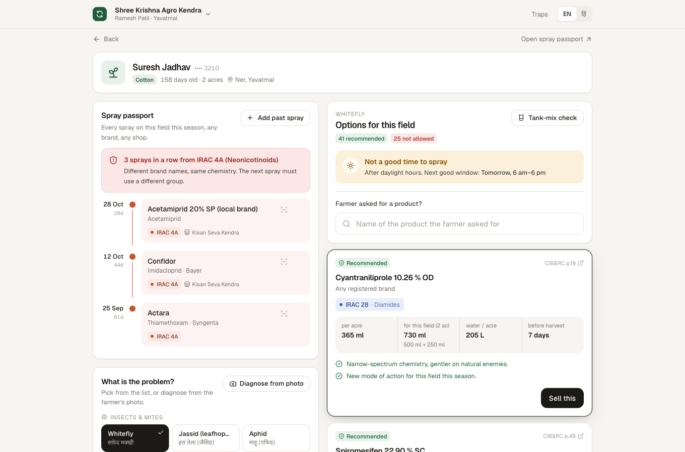
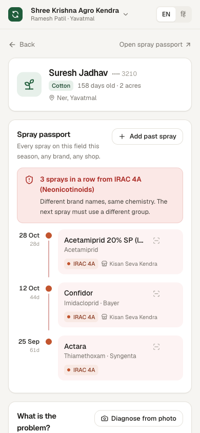
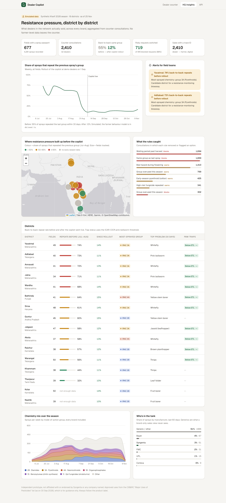
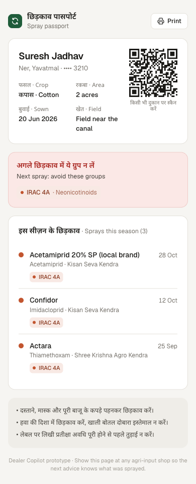

# Dealer Copilot

**Rotation-safe, label-approved crop protection advice at the agri-input counter.**

Every spray recommendation in India — from a crop-doctor app, a government advisory, or the dealer behind the counter — is made without knowing what has already been sprayed on that field. The same active ingredient is sold under dozens of brand names, so a farmer who "switches brands" often sprays the same mode of action again. That is how resistance builds, and resistance destroys molecules that cost about **$307M and 11.4 years** to bring to market (AgbioInvestor, 2026).

About **52% of Indian farmers take plant-protection advice from the pesticide dealer**. Dealer Copilot gives that counter a memory:

1. **Scan what was sprayed.** Photograph empty bottles or the last bill; the active ingredient is mapped to its IRAC/FRAC mode-of-action group, whatever the brand or shop.
2. **Check it against the label.** Only uses approved by CIB&RC for that crop and pest are offered, with dose, water volume and pre-harvest interval.
3. **Rotate, don't repeat.** Options that repeat the last spray's group, overuse a group this season, or break the waiting period are blocked, with the reason in English and Hindi.

> Independent prototype. Not affiliated with or endorsed by Syngenta or any company named. The CIB&RC list is published for guidance; always follow the product label.

| Dealer counter (desktop) | Phone: the repeat alert on the spray passport |
| --- | --- |
|  |  |

| HQ insights | Farmer's spray passport |
| --- | --- |
|  |  |

## What it does

**At the counter** (`/counter`, mobile-first, English/Hindi)
- Find the farmer by phone number (stored only as a salted HMAC) and open the field's **spray passport**: every spray this season, colour-coded by mode of action, with a red alert when the same group was sprayed back to back.
- Add past sprays by **photographing a bottle or bill** (Gemini reads the label into strict JSON), from sample bottles in demo mode, or by search across 26 brands and 486 registered formulations.
- **Label checks on every scan**: formulation not in the registered list (possible spurious product), look-alike brand names ("Super Actara Gold" is not Actara 25 WG), expired stock, missing CIR registration number.
- Pick the problem from a bilingual list or **diagnose from a crop photo** (top 3 candidates with confidence; the model may only choose from that crop's pest list).
- **Ranked options** for that field: dose per acre, quantity and packs for the field (rounded up to the full label rate), water volume, waiting period, CIB&RC page reference, and every reason an option is recommended, cautioned or blocked.
- **"Farmer asked for X?"**: check a named product against this field. This is the moment the copilot changes a sale.
- **Tank-mix check**: duplicate ingredients (a double dose) and same-group mixes.
- **Spray-weather window** from the Open-Meteo forecast: rain within 4 h, wind, heat.
- **Record the sale** with a digital trace ID (the dealer → farmer link the draft Pesticides Management Bill 2025 asks for), and send the farmer a slip on WhatsApp in Hindi or English.
- **Pheromone-trap log** with the ICAR-CICR pink bollworm threshold (8 moths/trap on 3 consecutive days).

**For the farmer** (`/passport/:token`): a Hindi-first page with a QR code that any shop can scan, showing what was sprayed and which groups to avoid next.

**At HQ** (`/insights`): resistance pressure by district (map + table), weekly back-to-back repeat rate, which rules fired, trap alerts for field teams, the chemistry mix across the season, and the **share of sprays by manufacturer including generics**, which a brand-only sales view never sees.

**For engineers** (`/developers`, `/api/openapi.json`): the advice endpoints are stateless, so any retailer app can embed them.

## Architecture

```
Clients                     API (Next.js route handlers)                 Data
───────                     ────────────────────────────                 ────
Dealer counter UI  ──┐      zod-validated requests ──► OpenAPI 3         CIB&RC approved uses (JSON, versioned)
Retailer apps (REST) ├────► Vision: Gemini → strict JSON (facts only)    IRAC / FRAC MoA tables
WhatsApp share links ┘      Rules engine: pure TypeScript, unit-tested   Postgres: farmers, fields, sprays,
                            Server re-runs rules before any sale            consultations, sales, traps
                                                                         Open-Meteo forecast (30 min cache)
```

Design decisions:
- **The model never picks a product.** It only turns pixels into facts (ingredient, strength, formulation type, dates). Every recommendation comes from deterministic rules in `src/engine/`, so an agronomist can audit it and a unit test can pin it down.
- **Stateless advice API.** `/recommend`, `/check-product` and `/tank-mix` take the field and its history in the request, so they need no database and can sit behind any retailer app.
- **The server re-runs the rules before recording a sale.** A client cannot record the sale of a blocked option (`409 BLOCKED`).
- **Resilient AI calls.** Each model gets a 15 s timeout and the client falls through a model chain on overload, rate limits or timeouts (`GEMINI_MODEL`, `GEMINI_FALLBACK_MODELS`). This is not hypothetical: while testing in November 2026 the larger Flash models returned `503 high demand` or hung past 60 s, while the lite model answered.
- **Honest data.** The approved-use table is parsed from the government PDFs. Rows the parser cannot read confidently are skipped and counted, never guessed. Uncertain MoA classifications are flagged `confidence: "check"`.

### Rules (src/engine/rules.ts)

| Code | Effect | Rule |
| --- | --- | --- |
| `NOT_APPROVED` | block | Formulation not approved by CIB&RC for this crop + pest (or not registered at all) |
| `SAME_GROUP_AS_LAST_SPRAY` | block | Shares a mode of action with the last spray within 30 days |
| `GROUP_SEASON_LIMIT` | warn at 2, block at 3 | Group already used this many times this season |
| `PHI_EXCEEDS_HARVEST` | block | Pre-harvest interval runs past the next harvest or picking |
| `HIGH_RISK_FUNGICIDE` | warn | FRAC high-risk group (e.g. QoI/strobilurins) used again |
| `PYRETHROID_EARLY_COTTON` | warn | Pyrethroid before day 90 in cotton (whitefly resurgence) |
| `BEE_HAZARD_FLOWERING` | warn | Bee-toxic chemistry while the crop is flowering |
| `UNKNOWN_GROUP` | warn | Mode of action not confirmed, so rotation cannot be checked |
| `NEW_GROUP`, `SELECTIVE`, `NO_RESISTANCE_RISK` | good | Ranks fresh, narrow-spectrum and pheromone options higher |

## Data provenance

| Data | Source | Where |
| --- | --- | --- |
| Approved crop × pest × dose × waiting period | CIB&RC *Major Uses of Pesticides* (PPQS, Govt. of India), as on 30 Sep 2026 | `data/pipeline/extract_mup.py` → `data/generated/approved_uses.json` (811 rows for cotton, paddy, tomato, chilli) |
| Mode-of-action groups | IRAC MoA classification, FRAC code list | `data/reference/moa.json` |
| Pink bollworm trap threshold | ICAR-CICR PBW management strategies (2019) | `data/reference/pests.json` |
| Spray weather | Open-Meteo hourly forecast | `src/lib/weather.ts` |
| Brand → formulation | Public product listings (verify against the label) | `data/reference/products.json` |
| Counter activity on `/insights` | **Synthetic** Kharif-2026 season; every consultation decided by the real engine | `db/seed.ts` |

## Run it

```bash
createdb dealer_copilot
cp .env.example .env.local          # set PHONE_SALT; add GEMINI_API_KEY to enable photo reading
                                    # (restart `npm run dev` after editing .env.local)
npm install
npm run db:setup                    # migrations + synthetic season (demo farmer: 98765 43210)
npm run dev                         # http://localhost:4700
```

Rebuild the approved-use table from the official PDFs:

```bash
npm run data:download
python3 -m pip install -r data/pipeline/requirements.txt
npm run data:extract
```

## Tests and evaluation

```bash
npm test                     # 28 unit tests: rules engine + Gemini fallback (mocked network)
npm run eval                 # 9 counter scenarios + invariants across all 37 crop × pest pairs
npm run eval -- --baseline   # also ask a plain LLM the same 9 questions (needs GEMINI_API_KEY)
npm run eval:labels          # label reader vs ground truth, through the running API
node postman/build-collection.mjs && postman collection run postman/dealer-copilot.postman_collection.json
                             # 20 API requests, 37 assertions against the running server
```

Results (`gemini-3.5-flash-lite`):

| Check | Result |
| --- | --- |
| Rules-engine scenarios | 9/9; invariants hold for all 37 crop × pest pairs (never an unapproved use, never below the label rate) |
| Label reader on 6 images, 8 products (`eval/fixtures/labels`: synthetic labels with fictional brands, a Hindi label, a 3-line shop bill) | 8/8 formulations read exactly, 8/8 registration checks, 5/5 label warnings (expired, look-alike brand, missing CIR No.). Median latency 2.0 s on 10 Nov and 4.6 s on 25 Nov 2026; it varies with Gemini load |
| Photo diagnosis on 2 openly licensed crop photos (tomato late blight, whitefly), 10 Nov 2026 | correct top answer both times (85%, 95%), about 1.7 s |
| Plain LLM, same counter questions, no rules (runs on 10 and 25 Nov 2026) | both runs suggested emamectin benzoate 5% SG for tomato fruit borer, which the CIB&RC list approves for cotton, okra, chilli and others but not tomato. Otherwise it mostly avoided repeating the last group (the one repeat flagged on 25 Nov came 40 days after the last spray, which these rules also allow) |

What the baseline shows, honestly: when it is told the chemical names, a modern LLM reasons about rotation reasonably well. The copilot's value is elsewhere. It works from the bottle in the farmer's hand, including local brands whose ingredient a model cannot know. It only offers approved uses, with dose, packs and waiting period for that field. And every decision is a rule an agronomist can audit, not a sample from a model. The label fixtures are synthetic; real shop photos should replace them before quoting accuracy.

## Stack

Next.js 16 (App Router, route handlers) · React 19 · TypeScript · Tailwind CSS 4 · PostgreSQL 18 (`pg`, plain SQL migrations) · zod 4 (validation + OpenAPI generation) · Gemini via REST (structured output, model fallback) · Recharts · Leaflet · Vitest · Postman CLI · Python + pdfplumber for the data pipeline.

## Limitations and next steps

- Covers four crops (cotton, paddy, tomato, chilli) and foliar insecticides/fungicides. Herbicides and seed treatments are parsed but not yet offered.
- Rotation logic is a simplified form of IRAC/FRAC guidance and should be reviewed by an agronomist before field use; it is not live spray advice.
- Next: WhatsApp Cloud API bot on the same engine, offline-first PWA for low-connectivity shops, QR/serial authentication against the manufacturer's packaging data, Bhashini voice input, and a feed of anonymised spray sequences into pest and resistance forecasting models.
